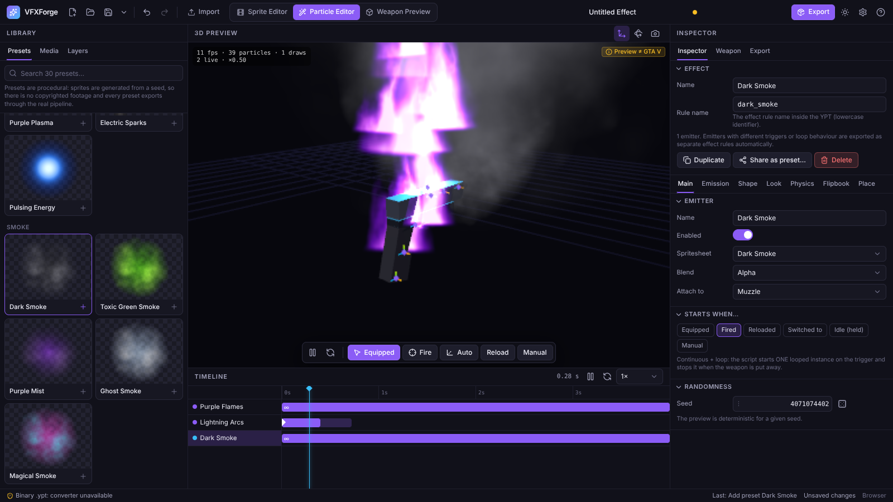
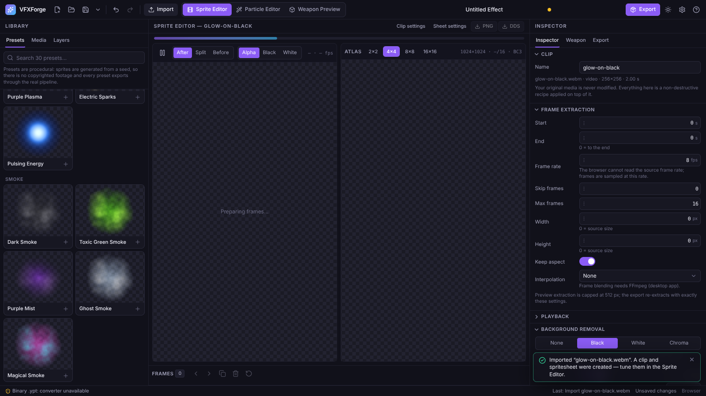
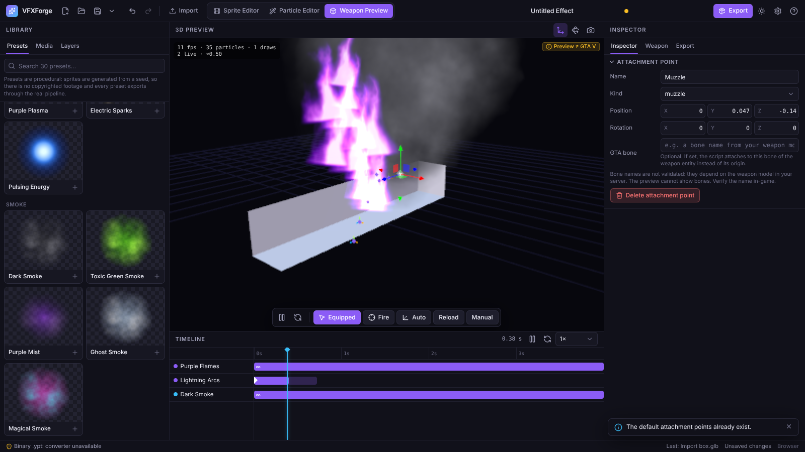

# VFXForge

**A desktop studio for custom FiveM weapon particle effects.** Import an image or video, turn it into an animated
spritesheet, design the particle effect around it, watch it on a weapon, and export a **validated** `.ypt` plus a
ready-to-run FiveM resource with Lua.



<p align="center">
 
</p>

## What it does

* **Import** MP4 / MOV / WebM / GIF / WebP / PNG / JPG (identified by contents, never modified) and 3D models (GLB, glTF, OBJ, FBX,
  and on the desktop app GTA V **.ydr** drawables, converted to GLB through the CodeWalker bridge: geometry only).
* **Spritesheets**: FFmpeg frame extraction, black / white / chroma keying with despill, colour, glow, motion blur, auto-crop,
  reverse / ping-pong, frame list editing, procedural animation of a single image, grid/padding/extrude atlas, **PNG and DDS (BC1/BC3/BGRA8)**.
* **Particle editor**: emission, shapes, physics, colour/size/alpha curves, flipbook animation, triggers; 30 procedural presets
  (Fire, Electricity, Smoke, Fantasy, Horror, Sci-fi); deterministic simulation.
* **Weapon preview** (WebGL): stand-in weapons or your model, attachment points with a gizmo, equip / fire / reload / holster
  simulation that mirrors the generated script, auto-scaling quality.
* **Export**: `.ypt.xml` → binary `.ypt` through CodeWalker **with a read-back check**, DDS textures, `fxmanifest.lua`, `config.lua`,
  `client.lua` (+ optional validated server relay), README with fidelity report — or a clearly-labelled source-only package.
* Undo/redo, autosave & crash recovery, project bundles, preset sharing, shortcuts, dark and light themes.

## What it is honest about

VFXForge **cannot launch GTA V**. It verifies everything it can offline and tells you exactly what it could not:

* The export is **blocked** (nothing written) if validation fails, the converter fails, or CodeWalker cannot read the binary back.
* Every property carries a fidelity status (*mapped / approximated / preview-only / not exported*) and a confidence
  (*verified / inferred / unverified*).
* The flipbook validator reports **structural** validity only — how the engine maps frame ids to UV rectangles is not
  verifiable outside the game, and the tool says so.
* The 3D view is labelled **“Preview ≠ GTA V”**.

Read [`docs/STATUS.md`](docs/STATUS.md) for the full verified / unverified list, and run
[`docs/FIVEM_TEST_CHECKLIST.md`](docs/FIVEM_TEST_CHECKLIST.md) before shipping an effect.

## Quick start

```bash
pnpm install
pnpm --filter @vfxforge/desktop dev          # UI in the browser (no FFmpeg / no binary .ypt in this mode)
pnpm --filter @vfxforge/desktop tauri dev    # the full desktop app (FFmpeg + converter)
```

For binary `.ypt` output and `.ydr` model import build the converter once against your own CodeWalker checkout —
[`docs/YPT_BRIDGE.md`](docs/YPT_BRIDGE.md).
FFmpeg is found via Settings → Tools, next to the app, or `PATH`.

## Documentation

| | |
|---|---|
| [User guide](docs/USER_GUIDE.md) | workflow, controls, troubleshooting |
| [Architecture](docs/ARCHITECTURE.md) | pipeline, packages, security, where honesty is enforced |
| [Status](docs/STATUS.md) | verified vs unverified, limitations, test inventory |
| [YPT bridge](docs/YPT_BRIDGE.md) | building the CodeWalker converter (binary `.ypt`, `.ydr` import) |
| [In-game checklist](docs/FIVEM_TEST_CHECKLIST.md) | what only the game can confirm |
| [Development](docs/DEVELOPMENT.md) | build, test, package |
| [YPT format notes](docs/research/ypt-format.md) | researched facts and their sources |

## Licensing

VFXForge is MIT-licensed. It does **not** include or link CodeWalker (GPL): the optional converter is a separate program
you build against your own CodeWalker checkout. Presets are procedural and contain no third-party footage.
